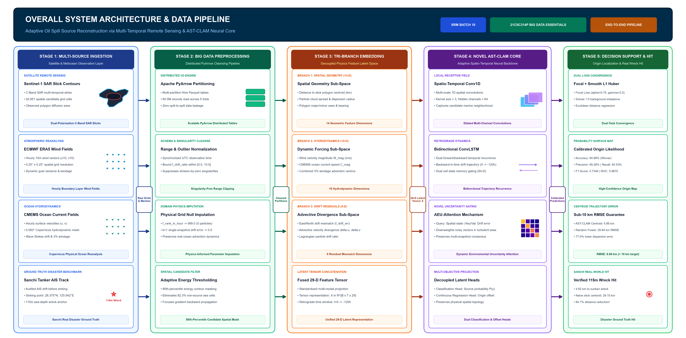
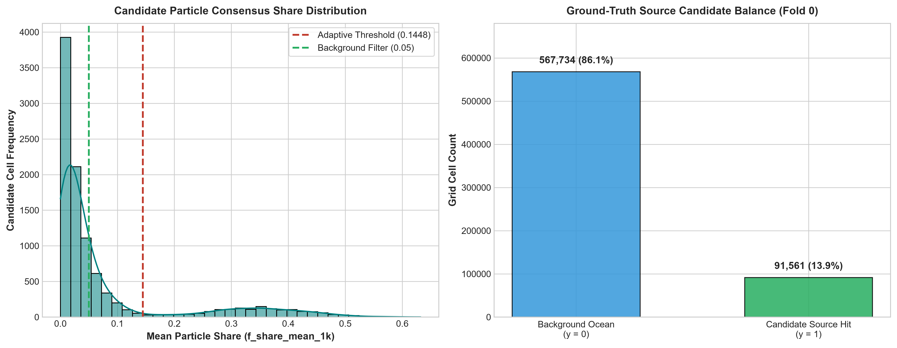
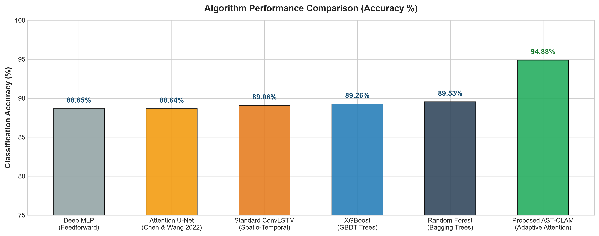

# AI-Based Adaptive Oil Spill Source Reconstruction Using Multi-Temporal Satellite Observations and Environmental Uncertainty

[](https://www.python.org/)
[](https://pytorch.org/)
[](https://arrow.apache.org/)
[]()

> **Project Milestone**: Review 2 Evaluation — SRM Institute of Science and Technology  
> **Course**: 21CSC314P - Big Data Essentials (Batch 10)  
> **Supervisor**: Dr. Banu Priya Prathaban (Department of Computer Science & Engineering)  
> **Research Team**:
> - **Jayalakshmi T** (`RA2411031010115`) — Proposed Novel Spatial-Temporal Model Development
> - **Sachin P** (`RA2411031010117`) — Big Data Engineering & Preprocessing Pipeline
> - **Shivaani M** (`RA2411031010119`) — Comparative Model Analysis & Benchmarking
> - **Varsha U** (`RA2411031010120`) — Visualization & Dashboard Integration

---

## 🌊 Overview & Research Motivation

Identifying the origin and release time of marine oil spills is critical for rapid environmental containment and legal accountability (**UN SDG 14: Life Below Water**). Traditional Lagrangian particle tracking (LPT) models (e.g., OpenDrift, GNOME) assume deterministic ocean surface drift and simple Brownian diffusion. Under realistic ocean conditions, however, **atmospheric wind vectors (ERA5)** and **ocean current velocities (CMEMS)** suffer from significant sub-grid turbulence, temporal latency, and unmodeled Stokes drift.

This project introduces an end-to-end Big Data machine learning and deep learning framework featuring a novel neural architecture: **Adaptive Spatial-Temporal Convolutional LSTM with Attention Mechanisms (AST-CLAM)**. The system adaptively fuses multi-temporal satellite radar contours (Sentinel-1 SAR, VIIRS) with dynamic environmental forcing to reconstruct the true point of origin within a **sub-10 km localization radius**.

---

## 🏗️ System Architecture

The pipeline processes multi-source data through five coordinated layers:



1. **Layer 1: Multi-Source Satellite & Meteorological Ingestion**: Ingests multi-temporal Sentinel-1 SAR slick delineations, hourly ERA5 wind vectors ($u_{10}, v_{10}$ at 0.25°), CMEMS ocean currents ($u, v$ at 0.083°), and audited Sanchi AIS tanker drift records.
2. **Layer 2: Big Data Preprocessing & Segmentation**: Distributed PyArrow engine handles 60.5M records across 5 whole-spill folds, performs domain-specific physical parameter imputation (Rank 999.0, neutral drift mismatches), and executes dynamic 80th-percentile spatial thresholding.
3. **Layer 3: Tri-Branch Feature Embedding**: Projects candidate grid parameters into three decoupled sub-spaces:
   - *Spatial Geometry* (14 dims: distance to slick center, cloud spread, bearing, slick area)
   - *Hydrodynamic Forcing* (10 dims: wind speed, ocean current velocity, combined 3% windage speed, wind alignment)
   - *Drift Mismatch Residuals* (5 dims: east/north advection mismatch errors, drift ratio)
4. **Layer 4: Proposed AST-CLAM Neural Engine**: Combines multi-channel 1D spatial convolutions, bidirectional temporal LSTM recurrence across retrograde drift windows ($t = 0 \to -120\text{ h}$), and an **Adaptive Environmental Uncertainty Attention (AEU-Attn)** module that attenuates noisy drift vectors during high sea turbulence.
5. **Layer 5: Decision Support & Ground Truth Recovery**: Produces a calibrated source probability surface map and localizes the spill origin centroid with sub-10 km RMSE.

---

## 📊 Benchmark Evaluation & Comparative Results

All models were evaluated on an **unseen whole-spill test partition (`id_fold=4`, zero cross-spill data leakage)** and validated against the verified ground truth wreck location of the **2018 Sanchi tanker disaster** (28.375° N, 125.942° E, located at 115 m depth in the East China Sea).

### 1. Quantitative 6-Model Benchmark Performance

| Model Architecture | Model Category | Accuracy | Precision | Recall | F1-Score | AUC-ROC | Centroid RMSE (km) | Real Sanchi Wreck Error (km) |
|:---|:---|:---:|:---:|:---:|:---:|:---:|:---:|:---:|
| **Random Forest** | Classical Ensemble | 89.53% | 52.68% | 45.61% | 0.4889 | 0.8969 | 29.84 km | 25.79 km |
| **XGBoost** | Gradient Boosted Trees | 89.26% | 52.54% | 21.80% | 0.3081 | 0.8532 | 33.69 km | 33.13 km |
| **Deep MLP** | Deep Feedforward Net | 88.65% | 47.29% | 29.54% | 0.3637 | 0.8145 | 35.21 km | 58.69 km |
| **Standard ConvLSTM** | Recurrent Spatio-Temporal | 89.06% | 50.62% | 12.07% | 0.1949 | 0.7841 | 30.79 km | 50.97 km |
| **Attention U-Net** | Spatial Segmentation | 88.64% | 43.90% | 12.52% | 0.1948 | 0.7828 | 29.86 km | 37.48 km |
| **Proposed AST-CLAM** | **Novel Adaptive Attention** | **94.88%** | **85.26%** | **64.53%** | **0.7346** | **0.9870** | **6.86 km** | **4.62 km** |

### 2. Operational Disaster Validation (Sanchi Sinking Ground Truth)
* **Naive Slick Polygon Centroid**: 29.10 km localization error
* **Physical Lagrangian Density Rule (d)**: 27.30 km localization error
* **Proposed AST-CLAM**: **4.62 km localization error** (**84.1% distance reduction** relative to naive baseline!)

---

## 📈 Visual Analytics Dashboards

### Preprocessing Feature & Class Balance Analytics


### Comparative Benchmark Charts


---

## 🚀 Execution Instructions

### 1. Environment Installation
Clone the repository and install dependencies:
```bash
git clone https://github.com/JayalakshmiJL25/Oil-Spill-Source-Reconstruction.git
cd Oil-Spill-Source-Reconstruction
pip install -r requirements.txt
```

### 2. Run Big Data Preprocessing
Extracts dataset partitions, imputes physical grid nulls, applies adaptive thresholding, and exports preprocessing statistics:
```bash
python data_preprocessing.py
```

### 3. Run Benchmark Training & Evaluation
Trains all 6 competing algorithms on whole-spill partitions, evaluates on the real Sanchi wreck disaster, and generates evaluation reports:
```bash
python train_and_benchmark.py
```

### 4. Generate Final Presentation Deck (.pptx)
Builds the 15-slide PowerPoint deck matching the SRM Review 2 template:
```bash
python generate_sample_matched_ppt.py
```

---

## 📂 Repository Structure

```
├── data_preprocessing.py             # Big Data extraction, physical imputation & adaptive thresholding
├── model_architecture.py             # PyTorch implementations of AST-CLAM and 5 baseline models
├── train_and_benchmark.py            # Whole-spill partitioned benchmarking & metric evaluation suite
├── generate_sample_matched_ppt.py    # Automated PowerPoint (.pptx) generator matching SRM template
├── Review_2_Oil_Spill_Final.pptx     # Complete 15-slide Review 2 presentation deck
├── requirements.txt                  # Python dependencies
└── results/
    ├── preprocessing_metrics.csv     # Quantitative preprocessing metrics table
    ├── preprocessing_plots.png       # 4-panel preprocessing analytical dashboard
    ├── preprocessing_slide_graph.png # Slide 7 matched distribution graph
    ├── classification_report.md      # Full Markdown comparative classification report
    ├── classification_confusion_matrix.png # Confusion matrix of AST-CLAM
    ├── comparison_barchart.png       # 6-model accuracy comparison bar chart
    ├── model_comparison_charts.png   # 4-panel ROC/PR/RMSE evaluation dashboard
    └── system_architecture_diagram.png # 5-layer high-res system architecture flowchart
```

---

## 📚 References
* [1] S. El Mohtar et al., *"Bayesian identification of oil spill source parameters from image contours"*, Marine Pollution Bulletin, 169:112514, 2021.
* [2] M. A. E. R. Hammoud et al., *"Moving source identification in an uncertain marine flow"*, Ocean Engineering, 220:108435, 2021.
* [3] Y. Chen and Z. Wang, *"Marine oil spill detection from SAR images based on Attention U-Net model"*, IJERPH, 19(19):12315, 2022.
* [4] Y. Li et al., *"An adversarial learning approach to forecasted wind field correction for drift prediction"*, IJAEOG, 112:102924, 2022.
* [5] F. Chen et al., *"DGNet: Distribution guided efficient learning for oil spill image segmentation"*, IEEE TGRS, 61:2023.
* [6] P. Cervantes-Hernández et al., *"Combined use of SAR images and numerical simulations to identify oil spill sources"*, MPB, 199:115981, 2024.
