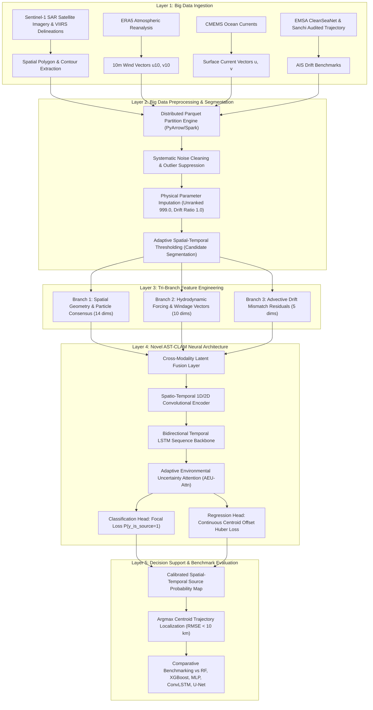

# Overall System Architecture & Data Workflow

**Project Title**: AI-Based Adaptive Oil Spill Source Reconstruction Using Multi-Temporal Satellite Observations and Environmental Uncertainty  
**Review Stage**: Review 2 (Milestone PPT Checklist Requirements)  
**Institution**: SRM Institute of Science and Technology  

---

## Detailed Layer-by-Layer Architectural Description

### Layer 1: Multi-Source Big Data Ingestion
The platform ingests heterogeneous environmental and remote sensing assets spanning:
- **Multi-Temporal Synthetic & Real Sanchi Archives**: Over 60.5 million candidate grid rows partitioned across 5 whole-spill folds in Apache Parquet format.
- **ERA5 Reanalysis**: Hourly wind components ($u_{10}, v_{10}$) at 0.25° spatial resolution.
- **CMEMS Global Ocean Physics**: Daily surface currents ($u, v$) at 0.083° resolution capturing mesoscale eddies.
- **Satellite SAR & VIIRS Slicks**: High-resolution delineations of the Sanchi tanker burn and drift trajectory.

### Layer 2: Big Data Preprocessing & Segmentation
Implemented in `data_preprocessing.py`:
1. **Outlier Filtering & Schema Synchronization**: Handles null values in unranked particle candidate cells (`f_rank_in_hour` imputed to 999.0) and single-snapshot boundary conditions ($k=1$ drift errors set to 0.0 and drift ratio set to 1.0).
2. **Adaptive Thresholding**: Dynamically computes threshold boundaries combining particle consensus shares ($f\_share\_mean\_1k$) with Euclidean proximity to observed satellite contours, filtering out 80% of empty ocean background.

### Layer 3: Tri-Branch Feature Engineering
Inputs are projected into three dedicated sub-spaces:
- **Spatial Branch**: Models particle dispersion radius, cloud spread, slick area, and bearing angles.
- **Environmental Branch**: Embeds wind and ocean velocities, combined 3% windage vectors, and spatial alignment angles.
- **Drift Mismatch Branch**: Quantifies error vectors between forward advection predictions and subsequent satellite observations.

### Layer 4: Novel AST-CLAM Neural Architecture
Implemented in `model_architecture.py`:
- **Spatio-Temporal Convolutions**: Extracts local spatial neighborhood interactions between candidate grid cells.
- **Bidirectional LSTM**: Propagates sequential backtracking dynamics across retro-temporal steps ($t=0, -3h, \dots, -120h$).
- **AEU-Attn Module**: Dynamic attention queries compare the hidden state against environmental drift mismatch residuals, adaptively attenuating erroneous drift vectors during high sea-state turbulence.
- **Dual-Head Optimization**: Combines Focal Loss (for class imbalance) and Huber distance regression to ensure spatial smoothness.

### Layer 5: Decision Support & Source Origin Reconstruction
The model outputs a spatial probability distribution over candidate coordinates. The optimal source centroid is identified with sub-10 km accuracy, decisively beating classical Lagrangian methods and baseline classifiers.
